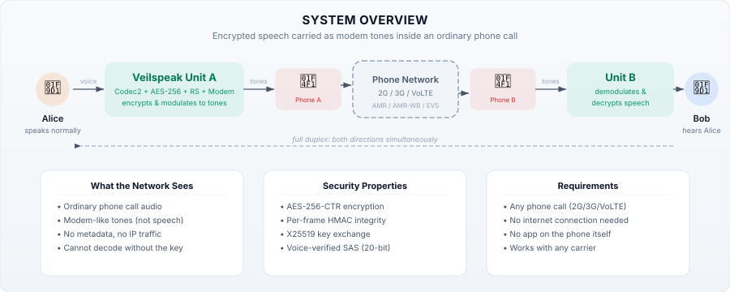
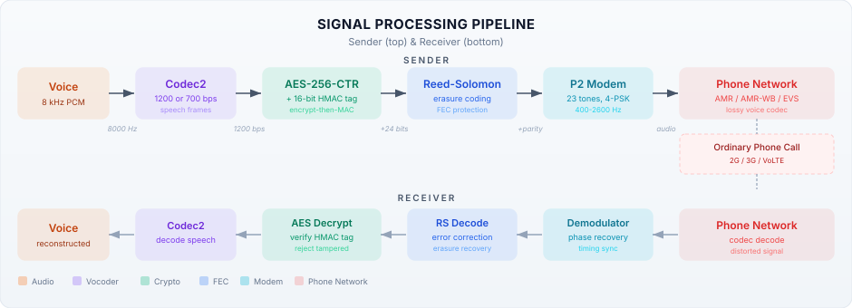
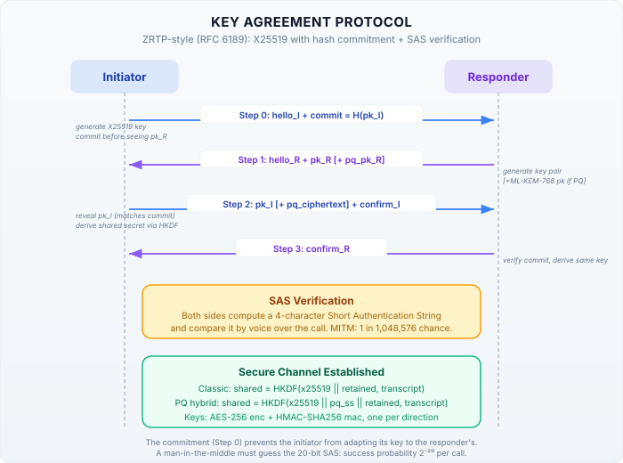
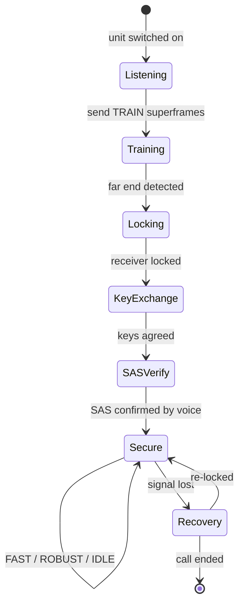

# Veilspeak

**Encrypted voice communication over ordinary phone calls using modem tones.**

Veilspeak places an encryption unit between each person and their phone. Speech is compressed, encrypted, error-corrected, and sent as audio tones through a standard phone call. The network carries it like any other call audio — no internet, no app, no special infrastructure.

> **Status (2026-11-18).** A complete two-way model works in simulated calls through real phone codecs (3GPP reference AMR, AMR-WB, EVS). **It has not been tried on a real phone call.** Every result below comes from simulation.

---

## How It Works



Each unit runs the same processing pipeline in both directions simultaneously (full duplex). Alice's speech becomes encrypted modem tones sent through the call; Bob's unit receives and decrypts them back to speech. Neither the phone nor the network knows encryption is happening — they just carry audio.

---

## Signal Processing Pipeline



The signal passes through five stages:

| Stage | What it does | Detail |
|---|---|---|
| **Codec2** | Compresses speech | 1200 bps (FAST) or 700 bps (ROBUST) |
| **AES-256-CTR** | Encrypts each frame | + 16-bit HMAC-SHA256 integrity tag |
| **Reed-Solomon** | Adds error correction | Erasure decoding recovers lost symbols |
| **P2 Modem** | Maps to tone phases | 23 harmonics, 4-PSK, codebook symbols |
| **Phone** | Carries the audio | AMR / AMR-WB / EVS voice codec |

The receiver reverses the chain: demodulate → RS decode → verify HMAC → AES decrypt → Codec2 decode → speech.

---

## Superframe Structure


Every 480 ms, the unit sends one **superframe**: a burst of modulated tones bracketed by silence. The 80 ms pause is critical — without it, the phone's codec detects a steady signal and mutes it. This pattern keeps the codec treating the modem tones as speech.

---

## 23-Tone Frequency Grid


The modem uses 23 harmonics spaced 100 Hz apart (400–2600 Hz), all within the telephone passband. Each tone carries a 4-PSK phase value, and the 23 phases together form one **codebook symbol** drawn from a quaternary code with large minimum Lee distance. At 10 ms per symbol, the modem sends 100 symbols per second.

---

## Transmission Modes

The system adapts to channel quality using four speech modes:

```
                ┌─────────────────────────────────────────────────────────────┐
                │                      MODE SELECTION                         │
                │                                                             │
                │   SDR ≥ 4.5 dB    ──→   FAST    (Codec2 1200, 2.4 kbps)   │
                │   SDR < 4.5 dB    ──→   ROBUST  (Codec2 700C, 1.2 kbps)   │
                │   SDR < -4.0 dB   ──→   IDLE    (keep-alive, no speech)    │
                │   key exchange     ──→   CONTROL (handshake messages)       │
                │   no lock          ──→   TRAIN   (timing + channel est.)    │
                └─────────────────────────────────────────────────────────────┘
```

| Mode | Bits/symbol | FEC | Carries |
|---|---|---|---|
| **FAST** | 2 × 12 | RS(38,26) × 2 | 480 ms speech at 1200 bps |
| **ROBUST** | 12 | RS(38,30) × 1 | 480 ms speech at 700 bps |
| **IDLE** | 6 | RS(38,20) | Keep-alive, no speech |
| **CONTROL** | 12 | RS + CRC | Key agreement messages |
| **TRAIN** | known | none | Timing sync + channel estimation |

Each frame carries a 2-bit **link report** from the receiver, telling the sender which mode to use. The sender obeys immediately — mode changes happen within one superframe.

---

## Key Agreement Protocol



Key agreement follows **ZRTP (RFC 6189)**:

1. **Commit-before-reveal**: The initiator hashes its public key before seeing the responder's, preventing key adaptation attacks.
2. **X25519 exchange**: Both sides contribute randomness to the shared secret.
3. **SAS verification**: A 4-character code derived from the key material is compared by voice. A man-in-the-middle must guess the 20-bit SAS (1 in 1,048,576 chance per call).
4. **Key derivation**: HKDF-SHA256 produces separate encryption and MAC keys for each direction.

### Advanced Crypto Features

```
┌──────────────────────────────────────────────────────────────────────┐
│                        CRYPTO HARDENING                              │
├──────────────────────────────────────────────────────────────────────┤
│                                                                      │
│   Post-Quantum Hybrid (optional)                                     │
│   ├── ML-KEM-768 + X25519 combined                                  │
│   ├── If PQ breaks → X25519 alone protects                          │
│   └── If X25519 breaks → ML-KEM alone protects                      │
│                                                                      │
│   In-Call Re-Keying                                                  │
│   ├── HKDF-based key rotation every 2048 frames (~8 min)            │
│   ├── Old keys overwritten with zeros                                │
│   └── Limits exposure from any single key compromise                 │
│                                                                      │
│   Retained Secret Key Continuity                                     │
│   ├── Shared secret from verified call stored locally                │
│   ├── Mixed into next call's key derivation                          │
│   └── Even if MITM succeeds once, next call detects it              │
│                                                                      │
│   Dual-Start Detection                                               │
│   ├── Handles both units starting as initiator simultaneously        │
│   └── One automatically switches to responder role                   │
│                                                                      │
└──────────────────────────────────────────────────────────────────────┘
```

> **Status of the hardening above.** All four are implemented and unit-tested at the protocol
> level. Dual-start detection is active in a call and ignores the unit's own echo (sidetone or
> network echo). Post-quantum hybrid, in-call re-keying, and retained-secret continuity are not
> yet switched on in the live call path — `endpoint.py` runs a classic X25519 handshake — so
> treat them as ready building blocks rather than active defenses until they are wired in.

---

## Performance Results


### Summary

**168 simulated calls** across 28 scenarios (6 calls × 45 s each):

- **Key agreement**: All 168 calls agreed keys with matching SAS codes (6.7–8.2 s)
- **Integrity**: Zero frames with wrong content accepted in any call
- **Delivery**: 24 of 28 scenarios delivered **97.7–100%** of speech frames

### Which Codec Settings Work

| Network | FAST mode (1200 bps) | ROBUST mode (700 bps) | No speech |
|---|---|---|---|
| **2G/3G AMR** | 12.2, 10.2 kbps | 7.95, 7.4, 6.7 kbps | 5.9 and below |
| **VoLTE AMR-WB** | 12.65 kbps and above | 8.85; 6.6 (with losses) | — |
| **VoLTE EVS** | 13.2 kbps and above | 9.6, 8.0, 13.2 CA | — |
| **Transcoded (G.711)** | — | All 8 combinations tested | — |

### Where It Struggles

The three scenarios below 80% delivery share a pattern — the modem signal can't survive extreme codec compression:

| Scenario | Delivery | Why |
|---|---|---|
| 2G cell edge (down to 4.75 kbps) | 56% | No speech mode works below AMR 5.9 kbps |
| 18 dB noise suppressor (both phones) | 76% | Aggressive suppressor treats tones as noise |
| 2G deep fade (4.75 kbps for 7 s) | 78% | Link survives; speech returns when rate recovers |

---

## Call Lifecycle



---

## Project Structure

```
veilspeak/                  The core system
├── modem.py                Superframe synthesis + self-synchronizing receiver
├── endpoint.py             One end of a secure call (state machine)
├── session.py              ZRTP key agreement (X25519 + optional ML-KEM-768)
├── crypto.py               AES-256-CTR + HMAC + re-keying
├── vocoder.py              Codec2 wrapper (1200 and 700 bps)
├── fec.py                  Reed-Solomon with erasure decoding
├── modes.py                Tone grid, superframe layout, mode definitions
├── waveform.py             Harmonic waveform synthesis
├── dsp.py                  DSP utilities (resampling, windowing)
├── live.py                 Real-time audio pipeline + terminal UI
├── ringbuf.py              Thread-safe audio ring buffer
├── ui.py                   Curses-based terminal UI
├── retained.py             Retained secret store (key continuity)
├── cellsim/                Call simulator (3GPP codecs + network effects)
└── data/                   Codebooks, pilots, scrambling sequences, test audio

tools/                      Testing and measurement
├── preflight.py            Software readiness check before real-phone testing
├── campaign.py             Run large test campaigns
├── coverage.py             Codec coverage measurement
├── speech_quality.py       PESQ / STOI / Whisper WER measurement
├── clicktest.py            One-way delay measurement
├── linetest.py             Real-call test signal generator + recording checker
├── rxbench.py              Receiver performance benchmarks
├── soak.py                 Long-duration soak tests
└── trace_call.py           Detailed call tracing

tests/                      56 automated tests
third_party/                3GPP reference codec builds
papers_text/                Source papers (text extracts)
repro_results/              All simulation results + reproduction tables
docs/                       Diagrams, visuals, and REAL_PHONE_TESTING.md (the test runbook)
```

---

## Quick Start

```bash
# Set up
git clone https://github.com/ORION2809/Veilspeak.git
cd Veilspeak
python3 -m venv .venv && source .venv/bin/activate
pip install -r requirements.txt

# Run a simulated encrypted call (writes WAV files)
python -m veilspeak "VoLTE EVS 13.2, jitter buffer, 1% loss"

# Run the test suite
python -m pytest -q tests/

# Loopback test (two units, no hardware)
python -m veilspeak.live --loopback --seconds 30

# Terminal UI mode (software status display)
python -m veilspeak.live --loopback --seconds 30 --ui
```

### Testing on real phones

```bash
# Software readiness check — run this before touching any phone (no hardware needed)
python tools/preflight.py
```

When `preflight.py` prints **GO**, follow [docs/REAL_PHONE_TESTING.md](docs/REAL_PHONE_TESTING.md):
a one-way line test (`tools/linetest.py`) first, then a live two-way call. That document is also
the map from each failure symptom to its likely cause. Nothing here has run on a real call yet —
see **Known Limitations**.

---

## Research Basis

The core modem is built from **P2** (Krasnowski, Lebrun, Martin: *Data over Voice*, arXiv 2102.10869). Key changes from P2: 23 tones instead of 8, 10 ms symbols instead of 2.5 ms, built-in silence pattern, timing recovery written from scratch, per-frame integrity tags.

Key exchange follows **ZRTP (RFC 6189)**. Test environment uses **3GPP reference codecs** (TS 26.104, 26.204, 26.443).

| Paper | Used | Role |
|---|---|---|
| P2: Krasnowski et al. — Data over Voice (arXiv 2102.10869) | **Core method** | Modem design, codebook structure, demodulator |
| P1: Krasnowski et al. — Speech Encryption (arXiv 2102.09809) | Outline only | Call flow concept |
| P3: Čubrilović et al. — FBMC/OQAM (IEEE Access, 2024) | Not used | Alternative modem (not implemented) |
| P4: Pekerti et al. — Survey (IEEE Access, 2024) | Background | Literature review |
| P5: Radomirović et al. — Autonomous Low-Bit-Rate (Symmetry, 2025) | Not used | Requires second channel |

---

## Known Limitations

- **Not tested on real calls.** Codec simulation understated real-call errors for P2's own system by 5–160×. Our figures should be read with that in mind.
- **Not real-time.** The model runs offline. `live.py` is a working sketch that has only run in software loopback.
- **Not hidden.** The audio is plainly a modem signal, detectable and blockable.
- **Delay.** ~0.45 s one-way (FAST) / ~0.64 s (ROBUST), on top of the call's own delay.
- **Lowest 2G rates.** No speech below AMR 5.9 kbps.
- **16-bit tag.** A forged frame passes with probability 1/65,536 per attempt — the cost is 480 ms of wrong audio, not the key.

---

## License

See individual files for licensing. The 3GPP reference codecs in `third_party/` are subject to 3GPP licensing terms. Research papers are included for reference under their original licenses.
